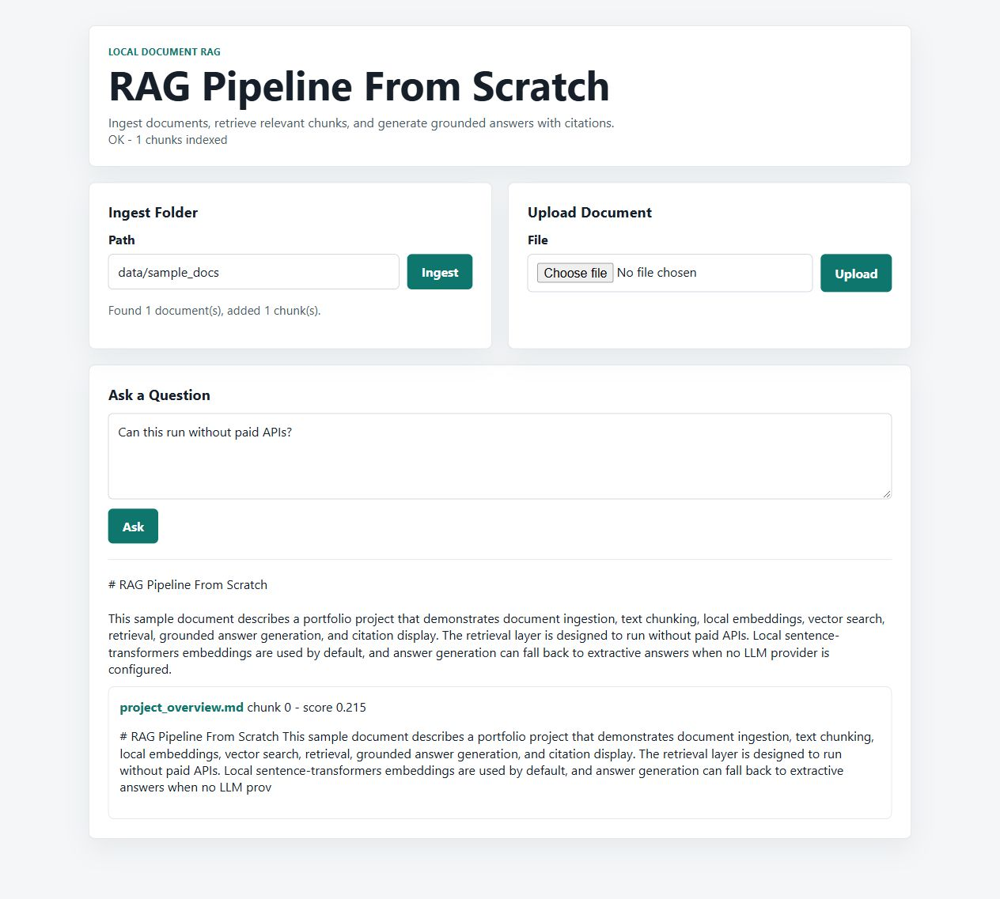

# Local retrieval demo

Use Python 3.12 in a fresh virtual environment:

```sh
pip install -r requirements.txt
python -m pytest -q
python -m evaluation.run
python -m evaluation.run --backend semantic
python run.py
```

The semantic benchmark downloads the public `all-MiniLM-L6-v2` model; neither benchmark uses paid LLM APIs. For a deterministic lexical demo, set `EMBEDDING_MODEL=hashing` before `python run.py` (PowerShell: `$env:EMBEDDING_MODEL = 'hashing'`). Leave `LLM_PROVIDER` unset.

Open `http://127.0.0.1:8000`, ingest `data/sample_docs`, and ask **Can this run without paid APIs?** The screenshot uses the hashing backend and included public sample document. Each benchmark JSON includes actual per-query answers and cited documents.



The server can ingest local paths, so bind it only to localhost. It is not a hardened multi-user document service. Similarity is a retrieval signal, not proof that the answer resolves the question.
